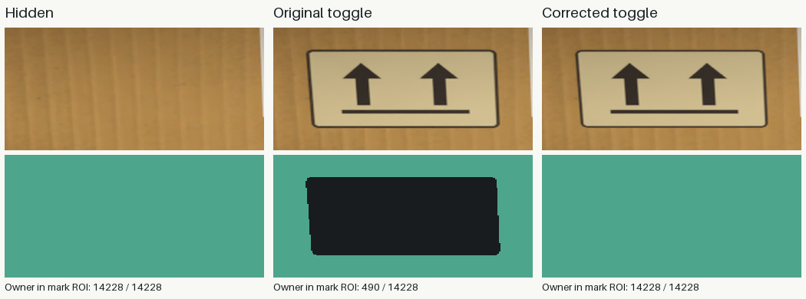
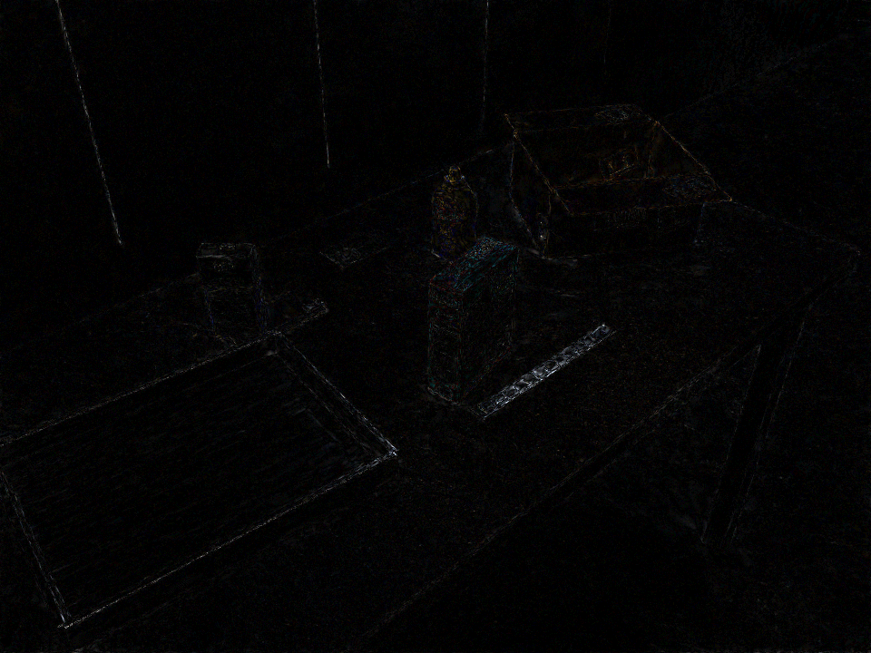

# issac-harness

[](LICENSE)

English | **[日本語](README.ja.md)**

OpenUSD と Omniverse Replicator は、テクスチャ切れ、カメラ属性の 100 倍単位ミス、数 mm の支持面浮き、途中フレームでの教師マスク欠落があってもエラーを出さずに描画を完了します。

`issac-harness` は、NVIDIA Isaac Sim 6.2.0 と Isaac Lab v3.0.0 向けに、これらの**静かな壊れ方を終了コード `1` で止める**ための検証・合成データ受入ハーネスです。GPU のない Mac / CI 上で数秒で終わる静的検査・CPU 試写と、ダイジェスト固定の NGC Docker コンテナ（Linux RTX ホスト）で回す Path Tracing 撮影・PhysX 接触試験・実写受入判定を分離しています。



GCE の NVIDIA L4 で撮影した RGB、教師マスク、BOP YCB-Video 実写との位置合わせ比較、検出器の実写評価（受入不合格の内訳を含む）を同梱しています。[L4 キャンペーン検証記録](evidence/campaign-l4/README.md) · [初期 L4 撮影・物理検証](evidence/gcp-l4/README.md)

---

## クイックスタート（GPU 不要・macOS / Linux CPU）

基本依存は `usd-core`・`pillow`・`numpy`・`scipy`・`zxing-cpp` のみです。`uv` があれば RTX GPU なしで静的検査、Blender Cycles による基準描画（4 カット）、ローカル 99 件のテストが動きます。

```sh
git clone https://github.com/ekusiadadus/issac-harness.git
cd issac-harness
uv sync --locked

# 1. 合成済みUSDの参照・材質・色空間・カメラ1/10単位・UV・支持面ギャップを検査
uv run --locked python -m harness check examples/inspection

# 2. CPU（Blender Cycles）で基準照明・減光照明を描画し、原寸比較HTMLを生成
uv run --locked python -m harness render examples/inspection --capture-only --out out/first-review

# 3. テストスイートの実行
uv run --locked python -m pytest -q
```

`out/first-review/index.html` をブラウザで開くと、全景・接写の原寸 PNG、輝度統計、EAN-13 バーコード復号結果を確認できます。

---

## このハーネスが止める具体的な不具合

すべてのモジュール（`harness/`）と制作規約（[`AGENTS.md`](AGENTS.md)）は、実際に踏んだ不具合を二度と通さないために追加したものです。

1. **FOV が一致してしまうカメラ単位の 100 倍ミス**
   `UsdGeomCamera` の焦点距離とフィルムバックは `1 scene unit` の `1/10`（`1 m/unit` で 58 mm レンズは `0.58`）です。分子と分母を両方 100 倍誤っても画角は一致するため、`scene.toml` の `focal_length_mm` と照合して検出します。
2. **クラス・個体マスクの相互照合をすり抜ける 13,738 画素のラベル欠落**
   近接撮影の途中フレームで表面デカールを非表示から表示へ切り替えると、クラス・個体両方のネイティブ出力で下の箱の 13,738 画素が背景 `0` に化けました（不透明メッシュでも 13,670 画素欠落）。対象部品を常時 RTX に登録して不要フレームではカメラ背後へ退避させ、`[[appearance_pairs]]`（`campaign label-invariance`）で往復差 0 画素を強制します。[詳細](docs/surface-marks.md)
3. **UV タイル外の黒潰れと「名前だけ違う同一材質」**
   `campaign texel-check` がワールド変換後の実寸 `texel/m` と `wrapS` / `wrapT` を検査し、`qualification.py` の `[min_distinct_texture_sets]` が設定名ではなく実際の base color・roughness・normal 画像ファイルの SHA-256 組を数えます。
4. **リセット直後の誤接触を見抜く物理対照試験**
   Isaac Lab（PhysX）での落下静定（`runtime/lab_smoke.py`）に加え、2 本指把持では「指を開いたまま同じリフト軌道を動かす対照試験」を対にし、初期フレームの指の原点収束による弾き飛ばしを検出します。[詳細](docs/contact-trials.md)
5. **実写基準に届かなければ `exit 1` を返す受入ゲート**
   `campaign release` は、独立プロセス再撮影の一致、登録済み実写との RGB-D 誤差、未学習の実写系列での検出 AP、原寸目視レビュー（`review.json` / `review.md`）が事前固定した閾値を満たさない限り終了コード `1` を返します。



---

## 自分の USD から合成データを作る

メートル・Z-up で制作した既存の OpenUSD ステージと、対象 prim を指定して開始します。

```sh
uv run --locked python -m harness campaign init assets/parts.usda \
  --target part=/Factory/PartA --target part=/Factory/PartB --out jobs/parts
uv run --locked python -m harness campaign plan jobs/parts/campaign.toml \
  --frames 50000 --shard-size 128 --seed 42 --out jobs/parts/plan.json
```

NVIDIA ドライバーと Docker のある Linux RTX ホスト（L4 / L40S / RTX 系。RT コアのない A100 / H100 は RTX 描画対象外）では、同梱の [`scripts/isaac_python.sh`](scripts/isaac_python.sh) がダイジェスト固定の NGC コンテナ起動、ホスト絶対パスの透過マウント、シェーダーキャッシュ再利用（`HARNESS_KIT_CACHE`）を処理します。

```sh
export ACCEPT_EULA=Y   # NVIDIA の使用条件に同意したホストで設定
export HARNESS_KIT_CACHE="$PWD/out/.kit-cache"

uv run --locked python -m harness campaign run-plan jobs/parts/campaign.toml \
  --plan jobs/parts/plan.json --out out/parts --max-shards 1 --asset-root "$PWD"
uv run --locked python -m harness campaign check out/parts \
  --count 128 --coco --out out/parts/labels
uv run --locked python -m harness campaign gallery out/parts \
  --indices 0 17 43 95 --out out/parts/review
```

Replicator の生の数値 ID はプロセス間で変わり得るため、クラス名から固定 ID へ変換し、閉区間のネイティブ矩形 `[x_min, y_min, x_max, y_max]` を半開区間へ正規化して出力します。手順の詳細は [キャンペーンの制作・評価](docs/campaigns.md) と [RTX・Lab の実行コマンド](runtime/README.md) を参照してください。

---

## 描画・検証コマンド一覧

| コマンド / スクリプト | 実行環境 | 検査・出力する内容 |
|---|---|---|
| `harness init scenes/my-cell` | CPU | サンプルシーン一式（USD・`scene.toml`・CC0 テクスチャ・出典台帳）を新ディレクトリへ複製 |
| `harness check <dir> [--nvidia out]` | CPU | 参照切れ、材質バインド、色空間、法線復号、UV、カメラ 1/10 単位、水平支持面ギャップ、公式 `usd-validation-nvidia 1.23.0` |
| `harness simready <asset.usdc>` | CPU | 公式 SimReady Robotics-Prop 5.0.0 検査 |
| `harness render --backend cycles\|storm\|rtx` | CPU / RTX | 同一 `scene.toml` からの全景・接写描画、輝度統計、EAN-13 復号、比較用 `index.html` / `review.md` |
| `harness accept <review-dir>` | CPU | 参照写真、画像 SHA-256、全行の目視所見・合否記入を照合（空欄は `exit 1`） |
| `runtime/lab_smoke.py` | Linux RTX | Isaac Lab v3.0.0（PhysX）で剛体を落下させ、支持面高さ差と静定速度を JSON 出力 |
| `harness campaign ...` | CPU / RTX | 計画作成、シャード撮影、再撮影比較、TUM レンズ歪み適用、実写 RGB-D 比較、検出転移評価、最終 `release` 判定 |

---

## ドキュメント

- [環境制作と画質レビュー](docs/authoring.md)
- [キャンペーンの制作・評価](docs/campaigns.md)
- [局所デカールと教師ラベル不変性試験](docs/surface-marks.md)
- [テクスチャ実寸密度の測定](docs/texture-scale.md)
- [同一クラスの形状差し替え](docs/asset-families.md)
- [実写との位置合わせと露出固定](docs/registered-quality.md)
- [カラー実機センサーの校正と再投影](docs/color-sensor.md) · [センサーモデル](docs/sensor-model.md)
- [写真 HDRI と環境照明](docs/environment-light.md)
- [接触・滑走・2本指把持の試験](docs/contact-trials.md)
- [RTX・Replicator・Isaac Lab 実行手順](runtime/README.md)
- [公開資料との対応](docs/references.md)

---

## スコープとライセンス

- **対象範囲**：OpenUSD ステージの構造整合性、固定カメラでの見え方・再現性、設定したコライダー上の PhysX 静定挙動、および事前固定した実写データに対する受入判定を行います。実機の床摩擦、モーター発熱、真空圧応答、安全インターロックの現地計測を置き換えるものではありません。
- **ライセンス**：本リポジトリのソースコード、設定、オリジナルの USD サンプル構成は [Apache License 2.0](LICENSE) で提供します。同梱するサードパーティ素材（Poly Haven / ambientCG の CC0 テクスチャ、および評価証跡に含まれる公開学術データセット BOP YCB-Video・TUM RGB-D 由来の比較資料）は各配布元のライセンスに従います（詳細は [`examples/inspection/ASSETS.md`](examples/inspection/ASSETS.md) と [`docs/references.md`](docs/references.md) を参照）。NVIDIA Isaac Sim / Isaac Lab コンテナの実行には NVIDIA の利用条件への同意が必要です。
